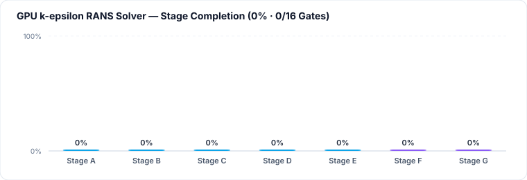

# GPU-Accelerated k–ε RANS Solver in Python — Engineering Portfolio

   

Building a verified, conservative finite-volume 2D incompressible RANS solver for wall-bounded channel flow from scratch in Python (FP64 on Laptop/VS Code → Numba-CUDA on Kaggle), implementing the standard high-Re k–ε closure, equilibrium wall functions, and scalable pressure solvers (CG, Geometric Multigrid, FFT + Parallel Cyclic Reduction).

## Visual Progress Overview

## Stage Progress Summary

| Stage | Platform | Progress | Tasks |
| :--- | :--- | :--- | :---: |
| **Stage A — Steady 1D Heat Conduction** | Laptop · VS Code · FP64 | `░░░░░░░░░░` 0% | 0/21 |
| **Stage B — Extend & Verify the Thermal Solver** | Laptop · VS Code · FP64 | `░░░░░░░░░░` 0% | 0/15 |
| **Stage C — Laminar Flow, Pressure–Velocity Coupling & Advanced Pressure Solvers** | Laptop · VS Code · FP64 | `░░░░░░░░░░` 0% | 0/23 |
| **Stage D — 1D Turbulent Channel Reference** | Laptop · VS Code · FP64 | `░░░░░░░░░░` 0% | 0/9 |
| **Stage E — 2D RANS CPU Solver** | Laptop · VS Code · FP64 | `░░░░░░░░░░` 0% | 0/6 |
| **Stage F — GPU Implementation & Hardware Experiments** | Kaggle · Numba-CUDA | `░░░░░░░░░░` 0% | 0/19 |
| **Stage G — Validation, Precision & Complete Performance Analysis** | Kaggle & Laptop | `░░░░░░░░░░` 0% | 0/9 |

## Verification Gates

| Gate | Stage | Criterion | Status |
| :--- | :---: | :--- | :---: |
| **Gate A1** | A | Matches analytical linear profile, constant flux, and global energy balance. | Pending |
| **Gate A2** | A | Hand check, code output, and global energy balance verified. | Pending |
| **Gate A3** | A | Matches analytical slab-plus-film resistance and energy balance. | Pending |
| **Gate A4** | A | Original nonlinear residual and global energy balance verified. | Pending |
| **Gate A5** | A | Local boundary residual < 0.01 W/m², field convergence distinguished from boundary convergence, and all edge cases pass. | Pending |
| **Gate B1** | B | Matches quadratic steady analytical profile and global source balance. | Pending |
| **Gate B2** | B | Explicit/implicit updates match hand checks and temporal refinement expectations. | Pending |
| **Gate B4** | B | 2D conservation and refinement orders verified; reference outputs archived. | Pending |
| **Gate C1** | C | Velocity profile and wall shear match analytical Poiseuille solution. | Pending |
| **Gate C2** | C | Variable-viscosity stress and scalar convection operators verified independently. | Pending |
| **Gate C3** | C | Truly 2D analytical or manufactured solution passes; post-projection discrete continuity satisfied to tolerance. | Pending |
| **Gate C4–C6** | C | Compare CG, Multigrid, and FFT+Thomas on the same channel (setup time, warmed solve time, total time to identical true residual and corrected divergence, scaling, anisotropy sensitivity, and pressure solver runtime share). | Pending |
| **Gate D** | D | Converged 1D channel solution with documented residuals, momentum/shear-stress balance, positivity diagnostics, and post-convergence first-cell y+ verification. | Pending |
| **Gate E** | E | 2D matches 1D reference, discrete continuity, residuals, mean-flow symmetry, and positivity diagnostics (without claiming separated-flow validation). | Pending |
| **Gate F** | F | Every GPU operator and complete timestep matches the FP64 CPU reference within agreed tolerance. | Pending |
| **Gate G** | G | Grid convergence, DNS validation, precision study, and complete evidence CSV verified with measured outputs. | Pending |

## Portable Project Status Log

| Field | Current Entry |
| :--- | :--- |
| **Current Stage / Lesson** | Stage A — Lesson A1 (Steady 1D Heat Conduction, Dirichlet BCs) |
| **Next Immediate Task** | Complete Lesson A1 (VS Code setup, 3-cell slab handwork, slab_conduction.py, full-width wall bug fix) |
| **Completed Derivations** | None yet |
| **Implemented Functions & Files** | None yet (next: slab_conduction.py) |
| **Verified Gates & Reference Data** | None yet |
| **Key Decisions & Notation** | k_s = thermal conductivity; k = TKE; π = p/ρ + 2k/3; positive heat rate rightward |
| **Unresolved Issues / Deferred Tests** | None yet |

## Hand Calculations & Derivations (Google Drive)

All handwritten finite-volume derivations, stencil traces, and verification sheets are archived in [Google Drive — Hand Calculations](https://drive.google.com/drive/folders/1QqdenkA5p63SgZNKboxu_S2nYWsFXHry).

## Detailed Roadmap & Checklist

### Stage A — Steady 1D Heat Conduction (Laptop · VS Code · FP64)

#### Setup & Lesson A1 — Dirichlet BCs & Independent Faces
- [ ] Select native Python interpreter in VS Code and create slab_conduction.py.
- [ ] Handwork: 0.30 m slab, A = 0.020 m², k_s = 10 W/(m K), T_L = 390 K, T_R = 330 K, 3 equal cells — sketch centres/faces, analytical T, 4 face heat rates (positive rightward), and net outward heat rate per cell using half-cell wall distances.
- [ ] Code: Implement boundary and interior Fourier fluxes in slab_conduction.py using numbers, arithmetic, print, and list indexing; save as a reusable test.
- [ ] Parallel Reasoning 1 (Independent faces): Predict whether face execution order matters, assign face indices to 2 workers, and compare forward vs. scrambled iteration order against hand calculations.
- [ ] Debugging: Diagnose a wall boundary bug using full cell width instead of half-cell width (identify the 2 affected face entries, quantify cell imbalances, and repair).
- [ ] Gate A1: Matches analytical linear profile, constant flux, and global energy balance.

#### Lesson A2 — Neumann BCs & Compatibility
- [ ] Derive boundary assembly for specified outward heat flux (including insulated boundary).
- [ ] Hand-solve and code a mixed Dirichlet–Neumann slab.
- [ ] Test a steady pure-Neumann case: verify source/flux compatibility, expose a deliberately incompatible case, and fix the additive temperature constant.
- [ ] Gate A2: Hand check, code output, and global energy balance verified.

#### Lesson A3 — Robin Convection BC
- [ ] Derive combined half-cell conduction + convection resistance for outward flux h(T_s − T_inf) at unknown surface temperature T_s.
- [ ] Distinguish mixed BCs on opposite ends from a Robin law on one face.
- [ ] Hand-solve and code the Robin boundary; verify against full slab + film resistance steady reference.
- [ ] Gate A3: Matches analytical slab-plus-film resistance and energy balance.

#### Lesson A4 — Nonlinear Radiation BC
- [ ] Derive local conduction–radiation balance for diffuse grey surface (ε_s σ (T_s⁴ − T_sur⁴) in kelvin, unit view factor).
- [ ] Implement and compare bisection, lagged radiative coefficient, and safeguarded Newton iteration.
- [ ] Gate A4: Original nonlinear residual and global energy balance verified.

#### Lesson A5 — Combined Convection & Radiation at One Face
- [ ] Derive residual (outward conduction minus outward convection and radiation) and its derivative for T_inf ≠ T_sur; couple surface solve back to adjacent cell.
- [ ] Handwork + Code: T_cell = 600 K, wall distance 0.010 m, k_s = 1 W/(m K), h = 20 W/(m² K), T_inf = 300 K, T_sur = 350 K, ε_s = 0.80, σ = 5.670374419e−8 — bracket T_s, take 2 Newton steps from 500 K, tabulate fluxes, finish in code to residual < 0.01 W/m², and compare with bisection.
- [ ] Verify edge cases: convection-only (ε_s = 0), radiation-only (h = 0), and surroundings heating the wall.
- [ ] Gate A5: Local boundary residual < 0.01 W/m², field convergence distinguished from boundary convergence, and all edge cases pass.

### Stage B — Extend & Verify the Thermal Solver (Laptop · VS Code · FP64)

#### Lesson B1 — Tridiagonal Assembly, Thomas Algorithm & Volumetric Heat Generation
- [ ] Introduce for/range, functions/return, and compact tridiagonal coefficient arrays.
- [ ] Handwork: Solve a 3-unknown tridiagonal system via Thomas elimination (modified coefficients, back-substitution, residual check).
- [ ] Implement Thomas solver and add volumetric heat generation to the 1D conduction solver.
- [ ] Gate B1: Matches quadratic steady analytical profile and global source balance.

#### Lesson B2 — Unsteady 1D Diffusion (Explicit & Implicit) + Parallel Reasoning 2
- [ ] Handwork: Compute diffusion number and 1 explicit forward-Euler step; assemble a small implicit backward-Euler system for identical IC/BCs.
- [ ] Parallel Reasoning 2 (Neighbour dependence): Trace forward/reverse sweeps of a 3-point explicit stencil on 5 cells with fixed ends using double buffering vs. in-place updates; locate overwritten reads and define safe buffer swap points.
- [ ] Implement explicit (double-buffered) and implicit (Thomas-backed) time marching using typed NumPy arrays and slicing.
- [ ] Gate B2: Explicit/implicit updates match hand checks and temporal refinement expectations.

#### Lesson B3 — Parallel Reasoning 3 & 4 (Reductions & GPU Prep)
- [ ] Parallel Reasoning 3 (Shared results): Trace race conditions in a residual sum across 2 workers, fix with private partial sums, and inspect floating-point summation-order differences against a serial reference.
- [ ] Parallel Reasoning 4 (CPU prep for GPU port): Map 1 face per worker on paper and verify index coverage in CPU code.
- [ ] Unfamiliar Loop Checkpoint: Independently design parallel execution (reads, writes, dependencies, ordering) for a new loop with no template.

#### Lesson B4 — 2D Steady & Unsteady Diffusion
- [ ] Extend mesh, face conductance, boundary assembly, and residual diagnostics to 2D structured NumPy arrays.
- [ ] Verify with hand checks and spatial/temporal grid refinement.
- [ ] Save small FP64 CPU reference cases for Stage F GPU verification.
- [ ] Gate B4: 2D conservation and refinement orders verified; reference outputs archived.

### Stage C — Laminar Flow, Pressure–Velocity Coupling & Advanced Pressure Solvers (Laptop · VS Code · FP64)

#### Lesson C1 — 1D Fully Developed Plane Poiseuille Flow
- [ ] Define channel half-height h, full height 2h, coordinates, ρ, ν, prescribed streamwise forcing g, and sign conventions.
- [ ] Map conduction coefficients and source bookkeeping to viscous momentum diffusion with no-slip walls.
- [ ] Gate C1: Velocity profile and wall shear match analytical Poiseuille solution.

#### Lesson C2 — 2D Staggered Mesh, Continuity & Conservative Convection
- [ ] Define cell-centred pressure/scalars, staggered face-normal velocities, ghost cells, and exact array shapes.
- [ ] Handwork (Continuity): Tabulate oriented face flows and cell net outflows; verify internal face cancellation.
- [ ] Handwork (Convection): Compute upwind vs. central face values and transported fluxes, including flow reversal.
- [ ] Implement conservative convection (first-order upwind first, then justified higher-order extension) and full variable-viscosity stress tensor ∇·[2(ν + ν_t)S].
- [ ] Gate C2: Variable-viscosity stress and scalar convection operators verified independently.

#### Lesson C3 — Fractional-Step Projection & Baseline Iterative Pressure Solvers
- [ ] Derive predictor, pressure/pressure-correction Poisson equation, velocity/flux correction, substep BCs, and periodic/Neumann compatibility + gauge fixing.
- [ ] Verify discrete consistency of divergence D, gradient G, and pressure operator.
- [ ] Handwork: Trace 1 sweep each of Jacobi and Gauss–Seidel on a small pressure system; trace finite-volume projection (provisional velocities → pressure correction → post-correction divergence).
- [ ] Gate C3: Truly 2D analytical or manufactured solution passes; post-projection discrete continuity satisfied to tolerance.

#### Lesson C4 — Advanced Pressure Solver 1: Matrix-Free Conjugate Gradients (CG)
- [ ] Implement matrix-free stencil matvec and verify against a tiny explicitly assembled matrix.
- [ ] Establish symmetry and positive definiteness (nullspace handling; volume-weighted or symmetric integrated system for nonuniform cells) and diagonal preconditioning.
- [ ] Handwork: Trace 1 CG iteration on a supplied small SPD system; save as a unit test.
- [ ] Implement CG vector updates and stopping test on CPU.

#### Lesson C5 — Advanced Pressure Solver 2: Geometric Multigrid (V-Cycle)
- [ ] Consult Briggs, Henson & McCormick (A Multigrid Tutorial) and match mesh locations and boundary conventions.
- [ ] Demonstrate high-frequency error damping by a smoother; hand-calculate residual, restriction, coarse solve, prolongation, and updated fine-grid residual.
- [ ] Build 2-grid solver, then full V-cycle with per-level arrays, compatibility, and gauge handling.
- [ ] On a stretched wall-normal mesh, compare point smoothing vs. line relaxation (reusing Thomas solver) and semicoarsening if needed; combine a fixed SPD V-cycle with CG once preconditioner requirements are verified.

#### Lesson C6 — Advanced Pressure Solver 3: Direct FFT + Tridiagonal Channel Solver
- [ ] Apply DFT along uniform periodic streamwise x, derive discrete stencil eigenvalues, and reduce wall-normal equations to 1 tridiagonal system per mode (reusing Thomas solver) with zero-mode compatibility/gauge handling.
- [ ] Handwork: Transform a 4-cell mode, apply eigenvalue, and compare with direct stencil; implement tiny manual DFT test, then library FFT for production.
- [ ] Gate C4–C6: Compare CG, Multigrid, and FFT+Thomas on the same channel (setup time, warmed solve time, total time to identical true residual and corrected divergence, scaling, anisotropy sensitivity, and pressure solver runtime share).

### Stage D — 1D Turbulent Channel Reference (Laptop · VS Code · FP64)

#### Lesson D1 — RANS Derivation, Equations & Nondimensionalization
- [ ] Derive Reynolds averaging, closure problem, k, ε, Reynolds stresses, S_ij, Boussinesq approximation, modified kinematic pressure π = p/ρ + 2k/3, and separation of imposed mean pressure gradient g.
- [ ] Verify governing equations and standard constants against OpenFOAM kEpsilon; derive dimensions and domain of applicability.
- [ ] Define Re_b (explicitly stating h vs. 2h), Re_τ, u_τ, wall units (y+, U+, k+, ε+), and derive the half-channel balance (ν + ν_t) dU/dy = u_τ² (1 − y/h).

#### Lesson D2 — Equilibrium Wall-Function Formulation
- [ ] Select and cite one internally consistent equilibrium wall-function treatment (inspecting OpenFOAM conventions rather than copying isolated formulas).
- [ ] Derive wall-shear / u_τ calculation (including robust scalar iteration if needed), momentum-flux coupling, first-cell k/ε/P_k relations, and intended y+ range (never impose k = ε = 0 at the wall).

#### Lesson D3 — Nonuniform Wall-Normal Mesh, Source Linearization & 1D Solver
- [ ] Implement nonuniform wall-normal control volumes and face interpolation.
- [ ] Handwork: Compute linearized turbulence source update (implicit destruction) and under-relaxation for supplied positive k and ε.
- [ ] Implement 1D turbulent channel solver (prescribed forcing mode first; add distinct constant-bulk-flow-rate mode later without over-constraining both).
- [ ] Gate D: Converged 1D channel solution with documented residuals, momentum/shear-stress balance, positivity diagnostics, and post-convergence first-cell y+ verification.

### Stage E — 2D RANS CPU Solver (Laptop · VS Code · FP64)

#### Lesson E1 — 2D RANS Coupling
- [ ] Couple 2D momentum, pressure projection, k, ε, ν_t, and equilibrium wall functions on the staggered mesh.
- [ ] Verify 2D scalar transport operators independently.

#### Lesson E2 — 2D Verification & Modularization
- [ ] Recover the Stage D 1D turbulent reference from a streamwise-uniform 2D case.
- [ ] Test recovery from a small divergence-compatible mean-flow perturbation.
- [ ] Extract clean, reusable Python modules, configuration layer, and saved FP64 reference outputs for Kaggle.
- [ ] Gate E: 2D matches 1D reference, discrete continuity, residuals, mean-flow symmetry, and positivity diagnostics (without claiming separated-flow validation).

### Stage F — GPU Implementation & Hardware Experiments (Kaggle · Numba-CUDA)

#### Setup — Kaggle Environment & Baseline Check
- [ ] Import CPU modules, case inputs, verification checks, and saved FP64 reference outputs into a Kaggle notebook; run a small CPU reference case on Kaggle.
- [ ] Select GPU in Settings → Accelerator; run !nvidia-smi -L; record device model(s), VRAM, CPU, package versions, and FP64 dtype; establish version-saving and /kaggle/working output preservation.
- [ ] Run and verify a minimal FP64 Numba-CUDA kernel before marking GPU path ready.

#### Lesson F1 — First CUDA Kernel (Facewise Loop)
- [ ] Revisit Parallel Reasoning 4: map 1 output index to 1 GPU thread, derive grid/block launch size, add out-of-bounds guard, and implement Numba-CUDA kernel from a TODO skeleton.
- [ ] Test on a non-multiple of block size and compare every output against CPU FP64 reference.

#### Lesson F2 — Experiment 1: Representing a Number
- [ ] Predict and test (1 + delta) − 1 for FP32 vs. FP64 near 1 (explicit dtypes, runtime inputs, fast-math disabled); check spacing with NumPy; analyze small residual updates relative to stored fields.

#### Lesson F3 — Experiment 2: Kaggle CPU vs. 1× T4 (3-Point Diffusion Stencil)
- [ ] Benchmark identical FP64 3-point diffusion stencil (distinct in/out arrays) on CPU vs. custom CUDA kernel across mesh sizes.
- [ ] Measure transfer-inclusive vs. GPU-resident timings (warm-up, sync before/after, repeated runs, median & spread, output check); estimate bytes/cell and arithmetic intensity; locate crossover (or explain its absence).

#### Lesson F4 — Experiment 3: Following a Value Through Memory
- [ ] Trace k[i] from Python name → device global array → thread/registers/local/shared/caches → output; build ownership/visibility/lifetime/location table.
- [ ] Compare a fused nu_t kernel against a version materializing an intermediate array; keep result arrays allocated across steps; explain safe in-place vs. double-buffered stencils.

#### Lesson F5 — Porting Remaining Operators & Reductions
- [ ] Port convection, variable-viscosity diffusion, turbulence sources, wall functions, and GPU reductions (norms, dot products, mass flow).
- [ ] Keep evolving fields resident on GPU between timesteps; verify dependencies and synchronization before any kernel fusion.

#### Lesson F6 — Advanced Method 4: GPU Parallel Tridiagonal Solves
- [ ] Implement 1 serial Thomas solve per independent system in parallel on GPU.
- [ ] Derive and hand-trace 1 elimination stage of Parallel Cyclic Reduction (PCR) with old/new coefficient buffers; implement PCR and test boundary indices and non-power-of-two sizes.
- [ ] Benchmark across line lengths and batch sizes (memory traffic, synchronization, small-pivot checks) and select measured winner for the GPU channel solver.

#### Lesson F7 — Experiment 4: Deciding What to Store
- [ ] Implement three reuse patterns: (1) precomputed fixed wall distances, (2) on-the-fly nu_t reused only while inputs are current, (3) FP64 lookup table for implicit smooth-wall friction relation (or scalar viscosity–temperature fallback).
- [ ] Verify endpoints, unseen off-grid samples, worst interval, out-of-range handling, spacing/error/memory/timing trade-offs, break-even repeat count, and metadata-verified reload.

#### Lesson F8 — Experiment 5: Using Both T4s (If Available) & Gate F
- [ ] After 1-GPU correctness is verified, run 1 independent Reynolds-number case per GPU with explicit device assignment and separate allocations; record joint elapsed time, cases/hour, and per-case latency.
- [ ] Gate F: Every GPU operator and complete timestep matches the FP64 CPU reference within agreed tolerance.

### Stage G — Validation, Precision & Complete Performance Analysis (Kaggle & Laptop)

#### Task G1 — Grid & Iterative Convergence Studies
- [ ] Handwork + Code: Estimate observed order of accuracy from 3 meshes where refinement assumptions hold; distinguish numerical grid refinement from changing wall-function matching location y+.

#### Task G2 — DNS Validation
- [ ] Select a justified high-Re_τ DNS dataset from Moser–Kim–Mansour (1999) or Lee–Moser (2015) (avoid Re_τ = 180 as an unqualified high-Re wall-function target).
- [ ] Inspect metadata, normalization, exact Re_τ, and component definitions; compare bulk velocity, U+, k+, ε+, ν_t/ν, and total shear stress; separate discretization, closure-model, and wall-function error; document stress-anisotropy limitations.

#### Task G3 — Precision Study (FP64, FP32, Mixed Precision)
- [ ] Compare FP64, FP32, and selected mixed-precision variants (no fast-math or loosened tolerances without explicit validation).
- [ ] Measure cancellation, convergence stagnation, residual accuracy, post-projection divergence, and sensitivity of τ_w, k, ε, and ν_t.

#### Task G4 — Experiment 6: Complete Solver Benchmarking & Evidence Log
- [ ] Benchmark full solver to identical convergence/accuracy targets across mesh sizes (transparent CPU vs. optimized CPU vs. Kaggle GPU), reporting compilation/setup, transfers, kernel times, pressure solve share, full timestep, and total time to convergence.
- [ ] Produce compact CSV and summary (device, dtype, mesh, implementation, resident vs. transfer-inclusive timing, repetitions, error vs. reference, convergence status, iterations, bulk velocity, wall stress, max discrete divergence), leaving all measured fields blank until actual runs are recorded.
- [ ] Gate G: Grid convergence, DNS validation, precision study, and complete evidence CSV verified with measured outputs.

#### Optional Extension — Wall-Resolved Low-Re k–ε (Launder–Sharma)
- [ ] Retrieve exact equations, transported dissipation variable, damping functions, extra source terms, and BCs for OpenFOAM LaunderSharmaKE and validate against a low-Re_τ DNS case.

---
*Last updated from GPU k–ε RANS Solver Dashboard on 2026-11-23 06:57 UTC.*
